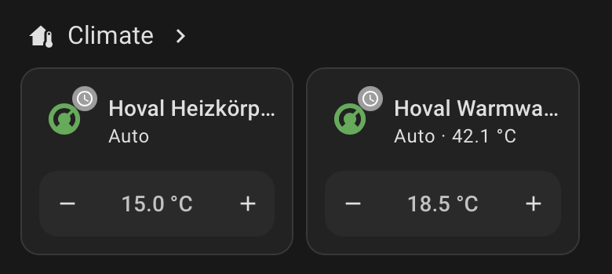
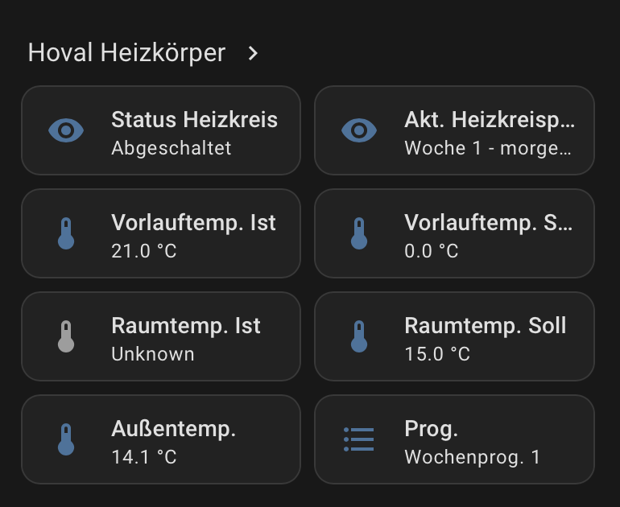
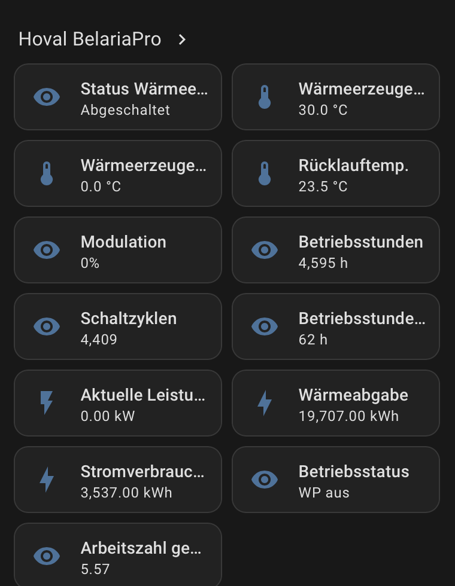
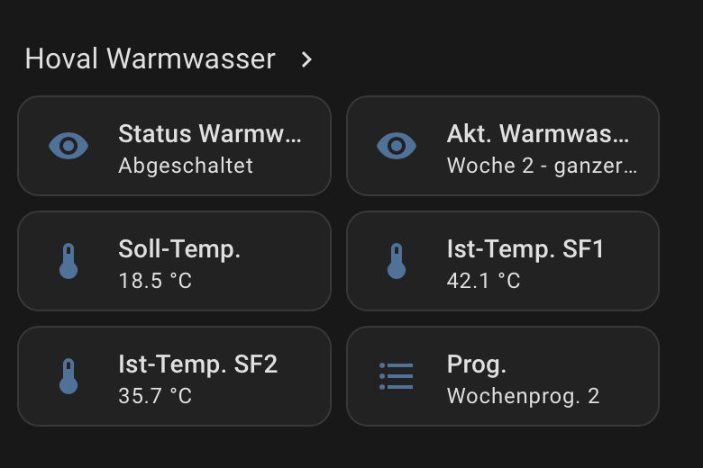
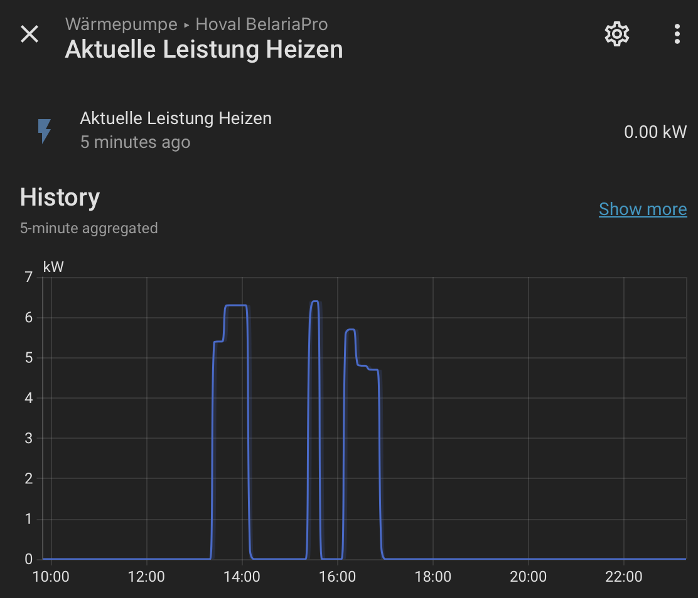
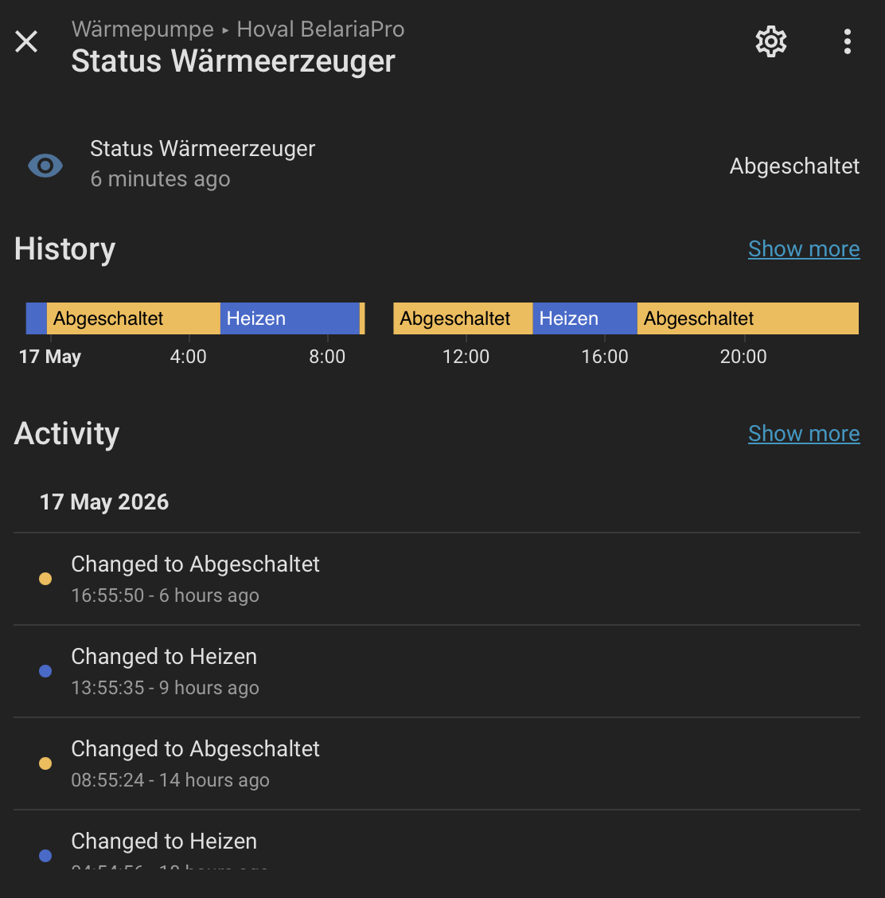

# Hoval Connect für Home Assistant

[English version](README.md)

[](https://github.com/chrisunderscorek/hovalconnect-ha/releases)
[](https://hacs.xyz)
[](LICENSE)

Inoffizielle Home-Assistant-Integration für Hoval Wärmepumpen über die
HovalConnect Cloud-API.

Dieses Projekt wird nicht von Hoval unterstützt. Es verwendet dasselbe
Cloud-Backend wie die offizielle HovalConnect Mobile-App und kann brechen, wenn
Hoval die API ändert.

## Status

Die Integration ist für meine eigene Hoval Belaria Anlage über die
HovalConnect App gebaut und getestet, inklusive WFA-200-Betriebsstatusdaten und
den üblichen Kreisen für Wärmepumpe, Heizkreis und Warmwasser.

Andere HovalConnect-kompatible Wärmepumpen können funktionieren, bleiben aber
Best-Effort, bis jemand sie testet und die verfügbaren Namen und Werte
meldet.

## Was die Integration macht

Die Integration erstellt native Home-Assistant-Geräte für die Anlage und ihre
Kreise, statt alle Entitäten in eine lange flache Liste zu legen:

- Hoval Anlage
- Wärmepumpe / Wärmeerzeuger
- Heizkreis
- Warmwasser

Entitätsnamen können auf Deutsch, Englisch oder in der
Home-Assistant-Systemsprache angezeigt werden. Die Spracheinstellung betrifft
nur diese Integration.

## Hauptfunktionen

- Anmeldung mit HovalConnect E-Mail und Passwort.
- Optionale dauerhafte Speicherung der Zugangsdaten; Tokens werden in jedem
  Fall gespeichert.
- OAuth-Token-Erneuerung nach der Hälfte der effektiven Token-Laufzeit.
- Retry-Handling für kurze Hoval-Cloud-Ausfälle und HTTP-`429`-/`5xx`
  Antworten.
- Cloud-Abfrageintervall von 30 Sekunden.
- Home-Assistant-Gerätegruppierung nach Anlage, Wärmepumpe, Heizkreis und
  Warmwasser.
- Deutsche und englische Namen für Entitäten, Programmwerte,
  Kreis-Statuswerte und WFA-200-Betriebsstatuswerte.
- Aktive Wochen-/Tagesprogrammnamen aus der API statt Rohwerten wie `week1`.
- Energiesensoren in `kWh` für Wärmeabgabe und Stromverbrauch des Inverters.
- Modulation wird auf `0%` normalisiert, wenn die Wärmepumpe aus ist oder
  wartet und die Cloud den Wert nicht liefert.
- Home-Assistant-App-Image für HAOS-Installation über ein Add-on-Repository.
- HACS/manuelle Installation bleibt über `custom_components/hovalconnect`
  möglich.

## Screenshots

Beispielhafte Home-Assistant-Geräteansicht mit deutschen Labels:

Für das aktiv getestete Belaria-Setup stellt Home Assistant die Werte dar, die
auch in der HovalConnect App angezeigt werden, und leitet zusätzlich
`Arbeitszahl gesamt` / COP aus Wärmeabgabe und Inverter-Stromverbrauch ab.

| Temperaturkarten | Heizkreis |
| --- | --- |
|  |  |

| Wärmepumpe / Wärmeerzeuger | Warmwasser |
| --- | --- |
|  |  |

Die Verlaufsansichten zeigen, wie sich Leistung und Status des Wärmeerzeugers
über den Tag verändern:

| Aktuelle Leistung Heizen | Status Wärmeerzeuger |
| --- | --- |
|  |  |

## Angezeigte Werte

Die exakten Entitäten hängen davon ab, was die Hoval Cloud für deine Anlage
liefert.

### Wärmepumpe / Wärmeerzeuger

- Heat generator status / `Status Wärmeerzeuger`
- WFA-200 operating status / `Betriebsstatus`
- Heat generator actual temperature / `Wärmeerzeuger-Ist`
- Heat generator target temperature / `Wärmeerzeuger Soll`
- Return temperature / `Rücklauftemp.`
- Compressor modulation / `Modulation`
- Current output heating / `Aktuelle Leistung Heizen`
- Operating hours / `Betriebsstunden`
- Operating hours over 50% / `Betriebsstunden > 50%`
- Switching cycles / `Schaltzyklen`
- Heat output energy / `Wärmeabgabe`
- Inverter energy use / `Stromverbrauch Inverter`
- Total performance factor / `Arbeitszahl gesamt`

### Heizkreis

- Heating circuit temperature control / `Hoval Heizkörper`
- Heating circuit program select / `Heizkreis Prog.`
- Heating circuit status / `Status Heizkreis`
- Active heating circuit program / `Akt. Heizkreisprog.`
- Flow temperature actual / `Vorlauftemp. Ist`
- Flow temperature target / `Vorlauftemp. Soll`
- Room temperature actual / `Raumtemp. Ist`
- Room temperature target / `Raumtemp. Soll`
- Outdoor temperature / `Außentemp.`

### Warmwasser

- Hot water temperature control / `Hoval Warmwasser`
- Hot water program select / `Warmwasser Prog.`
- Hot water status / `Status Warmwasser`
- Active hot water program / `Akt. Warmwasserprog.`
- Hot water target temperature / `Soll-Temp.`
- Actual temperature SF1 / `Ist-Temp. SF1`
- Actual temperature SF2 / `Ist-Temp. SF2`

## Steuerung

Die Integration enthält bereits Home-Assistant-Control-Entitäten für Werte,
die die HovalConnect Cloud-API offenbar ändern kann:

- Heizkreis-Solltemperatur
- Warmwasser-Solltemperatur
- Heizkreisprogramm
- Warmwasserprogramm

Auslesen, Gerätegruppierung, Lokalisierung, Energiezähler und Statusmapping
sind die aktiv getesteten Teile dieser Integration. Schreibunterstützung ist
geplant, wurde aber auf dem unterstützten Belaria-Setup noch nicht praktisch
getestet. Solltemperatur- und Programm-Schreibzugriffe sollten in `1.0.0` nicht
als für den normalen Betrieb unterstützt betrachtet werden, auch wenn die
Control-Entitäten bereits in Home Assistant vorhanden sind.

## Installation

### HAOS-App-Repository

Das ist der bevorzugte Installationsweg für dieses Repository.

1. In Home Assistant **Einstellungen > Add-ons > Add-on Store** öffnen.
2. Das Drei-Punkte-Menü öffnen und **Repositories** auswählen.
3. Dieses Repository hinzufügen:

   ```text
   https://github.com/chrisunderscorek/hovalconnect-ha
   ```

4. **Hoval Connect** installieren.
5. Die App einmal starten.
6. Auf die Logzeile der App warten:

   ```text
   Installed Hoval Connect integration <version>
   ```

7. Home Assistant Core neu starten.
8. Die Integration über **Einstellungen > Geräte & Dienste** hinzufügen.

Die HAOS-App ist ein One-Shot-Installer. Sie kopiert die gebündelte Custom
Integration nach:

```text
/config/custom_components/hovalconnect
```

Danach beendet sie sich. Sie ist kein dauerhaft laufender Dienst.

### Update über HAOS

Der Home-Assistant-Button **Update** aktualisiert nur das App-Image. Er kopiert
nicht die neuen Python-Integrationsdateien nach `/config` und startet Home
Assistant Core nicht neu.

Nach jedem App-Update:

1. Bei der Hoval-Connect-App auf **Update** klicken.
2. **Hoval Connect** einmal starten.
3. Auf die Installations-Logzeile warten.
4. Home Assistant Core neu starten.

### HACS oder manuelle Installation

Der Integrationscode bleibt unter `custom_components/hovalconnect` verfügbar.
Das ist nützlich, wenn du die Hoval-Connect-Integration vorher über HACS
installiert hattest oder eine manuelle Custom-Component-Installation
bevorzugst.

Für HACS:

1. HACS > Integrationen > Drei-Punkte-Menü > Benutzerdefinierte Repositories.
2. Dieses Repository als Kategorie **Integration** hinzufügen.
3. **Hoval Connect** installieren.
4. Home Assistant Core neu starten.

Für eine manuelle Installation kopierst du:

```text
custom_components/hovalconnect
```

nach:

```text
/config/custom_components/hovalconnect
```

Danach Home Assistant Core neu starten.

## Konfiguration

1. **Einstellungen > Geräte & Dienste** öffnen.
2. **Hoval Connect** hinzufügen.
3. HovalConnect E-Mail und Passwort eingeben.
4. Auswählen, ob Home Assistant E-Mail und Passwort dauerhaft speichern darf.
5. Integrationssprache wählen: **System**, **Deutsch** oder **English**.
6. Hoval Anlage auswählen.

E-Mail und Passwort werden nur gespeichert, wenn die dauerhafte Speicherung der
Zugangsdaten aktiviert wird. OAuth-Token-Daten werden im Home-Assistant-
Config-Entry gespeichert.

Die Sprache kann später in den Optionen der Integration geändert werden.

## Authentifizierung und Token-Erneuerung

Beim Setup tauscht die Integration deine HovalConnect-Zugangsdaten über SAP
IAS gegen OAuth-Tokens. Hovals Core-API erwartet aktuell einen JWT-förmigen
Bearer Token. Deshalb bevorzugt die Integration den JWT-förmigen `id_token`,
wenn SAP IAS zusätzlich einen opaken OAuth-`access_token` zurückgibt.

Token-Handling:

- Erneuerung nach der Hälfte der effektiven Token-Laufzeit.
- Refresh-Token-Erneuerung bevorzugen.
- Gespeicherte E-Mail/Passwort nur als expliziten Fallback verwenden, wenn
  aktiviert.
- Wenn die Erneuerung fehlschlägt, der aktuelle Token aber noch gültig ist,
  mit gestaffeltem Backoff erneut versuchen: 3x 10 Sekunden, 3x 30 Sekunden,
  3x 60 Sekunden, danach 120 Sekunden.
- Längere `Retry-After`-Antworten des Token-Endpunkts beachten.
- Re-Authentifizierung anfordern, wenn der Token abläuft und nicht erneuert
  werden kann.

## Hoval App-Version-Header

Die Hoval Cloud prüft die Frontend-App-Version, die von der offiziellen
Mobile-App gesendet wird. Diese Integration bringt `3.2.0` als
Fallback-Version-Header mit.

Beim Start und nach HTTP `426 Upgrade Required` versucht die Integration, die
aktuelle HovalConnect-Version aus Google Play zu lesen und verwendet sie, wenn
sie gefunden wird. Die Prüfung ist auf ein 6-Stunden-Fenster ab
Integrationsstart begrenzt, damit Installationen Hoval/Google nicht alle zur
gleichen Uhrzeit abfragen.

## API-Notizen

Die Integration verwendet diese Bereiche der Hoval Cloud:

- `GET /api/my-plants`
- `GET /v1/plants/{id}/settings`
- `GET /v3/plants/{id}/circuits`
- `GET /v3/api/statistics/live-values/{id}`
- `GET /v2/business/plants/{id}/circuits/{path}`
- `POST /v3/plants/{id}/circuits/{path}/temporary-change`
- `PATCH /v3/plants/{id}/circuits/{path}/programs`
- `POST /v3/plants/{id}/circuits/{path}/programs/{program}`

`docs/api-docs.json` enthält einen inoffiziellen OpenAPI-Snapshot von:

```text
GET https://azure-iot-prod.hoval.com/core/v3/api-docs
```

Der Snapshot ist nur eine Momentaufnahme der aktuell beobachteten API und keine
offizielle Hoval-Dokumentation.

## Debug-Tools

Das Verzeichnis `tools/` enthält lokale Hilfsskripte für Entwicklung und
HAOS-Checks. Ausführlichere Beispiele stehen in
[tools/README.md](tools/README.md).

- `tools/build_push_ghcr_app.sh`: Multi-Arch-HAOS-App-Images bauen und nach
  GHCR pushen.
- `tools/publish_pretest_config_only.sh`: nur `hovalconnect/config.yaml` auf
  den Remote-Branch `main` pushen, damit der HA Store Pretest-Versionen findet.
- `tools/pretest_ha_app_release.sh`: den normalen lokalen Pretest-Flow
  ausführen: Images bauen, die Config-only-App-Version veröffentlichen und die
  App auf HAOS aktualisieren/starten.
- `tools/update_ha_app_on_haos.sh`: den HA Store neu laden, die One-Shot-App
  auf HAOS aktualisieren/starten, auf die kopierte Integrationsversion warten
  und optional Home Assistant Core neu starten.
- `tools/check_ha_app_on_haos.sh`: App- und installierte Integrationsversion
  auf HAOS prüfen und ein weiterverwendbares JSON-Ergebnis ausgeben.
- `tools/debug_hoval_auth.py`: lokaler Hoval OAuth-/Token-, Store-Version- und
  API-Probing-Helper.
- `tools/analyze_ha_history_availability.py`: eine lokal kopierte
  Home-Assistant-Recorder-Datenbank auf `unavailable`-Phasen untersuchen.

Tokens, Home-Assistant-Recorder-Datenbanken oder private API-Ausgaben nicht
committen.

## Bekannte Grenzen

- Nur mein Belaria-Setup wird aktiv unterstützt und getestet.
- Andere HovalConnect-Anlagen können andere Namen oder Werte liefern.
- Die HovalConnect Cloud-API ist inoffiziell und kann sich ohne Ankündigung
  ändern.
- Schreibaktionen für Solltemperaturen und Programmauswahl sind geplant, aber
  noch nicht praktisch getestet.
- Zwei-Faktor-Authentifizierung wird nicht unterstützt.

## Lizenz

GPL-3.0-only. Siehe [LICENSE](LICENSE).

Versionen bis einschließlich `v0.2.2` wurden unter der MIT-Lizenz
veröffentlicht. Ab `v1.0.0` wird dieses Projekt unter GPL-3.0-only verteilt.
Siehe [NOTICE.md](NOTICE.md) für Upstream-Attribution und erhaltene
MIT-Hinweise.
